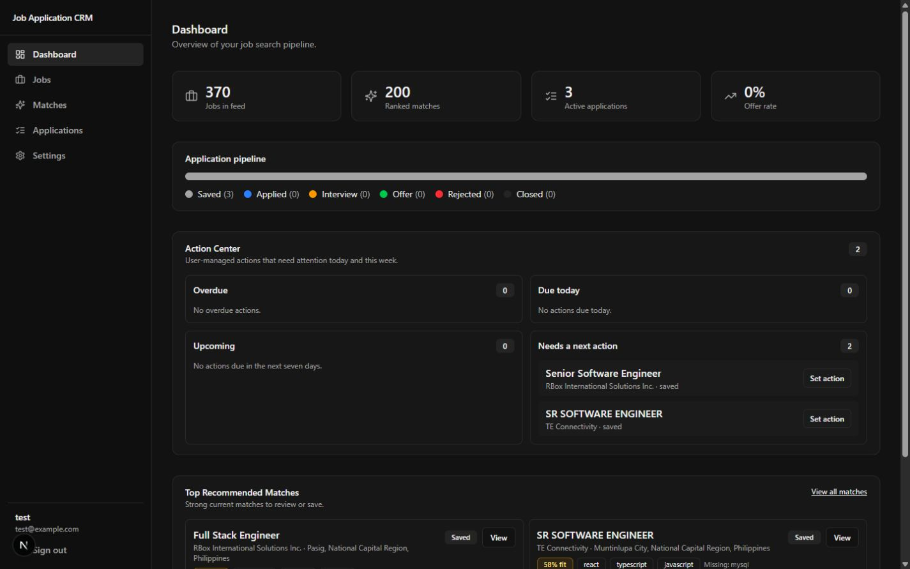
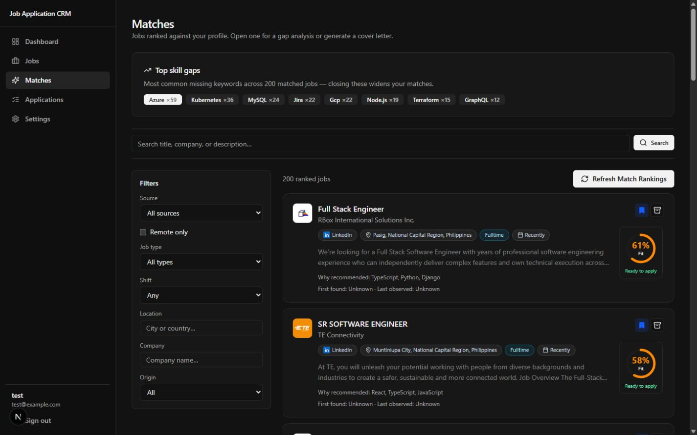
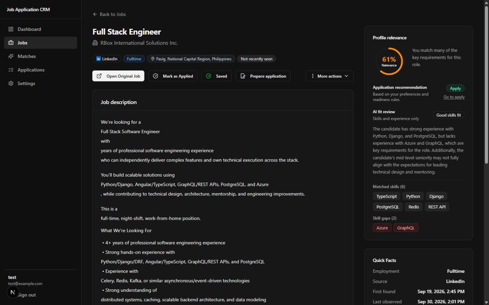
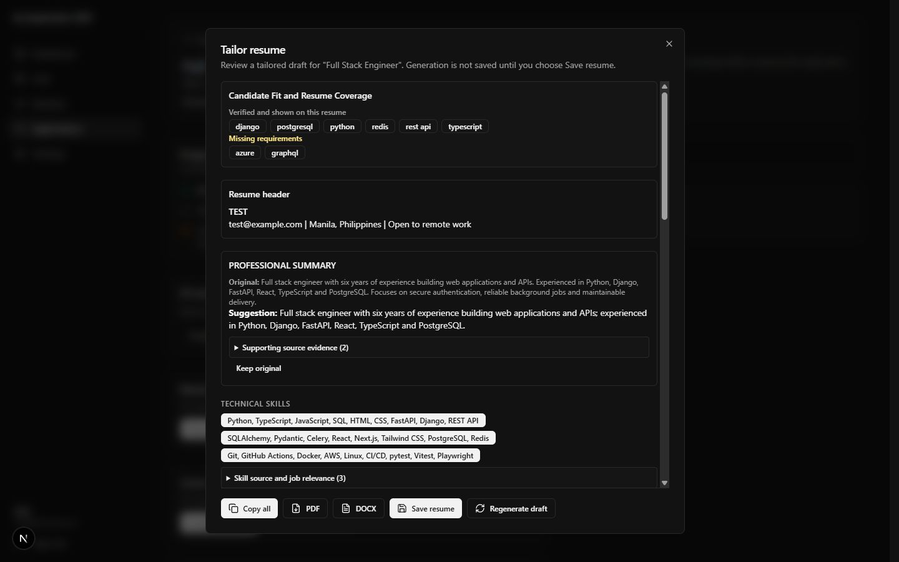
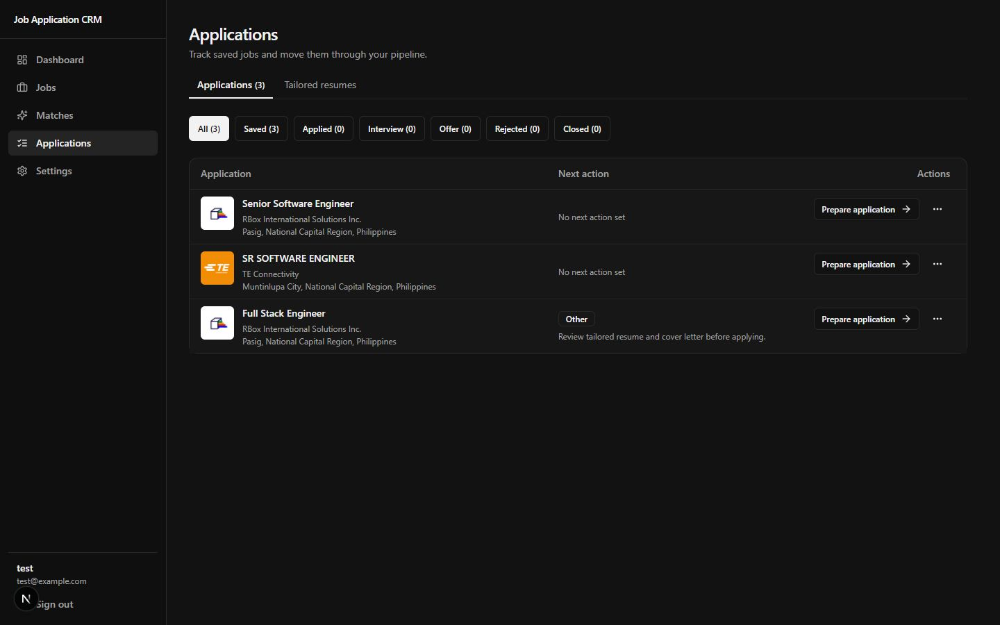
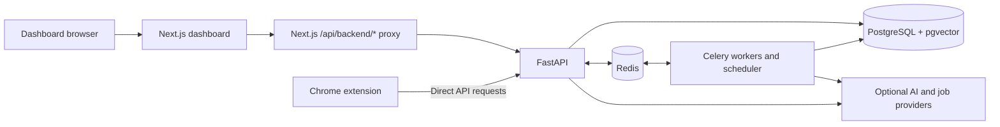

# Job application workspace

A job-search CRM for people who want to keep their job search in one place.
Save jobs, compare them with your resume, prepare application documents, and
keep track of what you sent and what to do next.

This portfolio project is under active development and is intended for local evaluation.



*The dashboard brings your job search and next actions together.*

Screenshots use the fictional `test@example.com` account and a fictional resume.
Company names and job listings come from the job feed; they do not represent
applications submitted by the demo account. Your counts and results will differ.

## How it works

### 1. Upload your resume

Create an account, then open **Settings → Profile** and choose a PDF or DOCX
resume. Review the extracted experience and skills before using them. Set your
target roles and locations under **Preferences**.

### 2. Find jobs and review your matches

Browse **Jobs**, search or filter the feed, and save jobs you want to consider.
Open **Matches** to see jobs ranked against your profile and common skill gaps.



*Matches help you decide which jobs deserve a closer look. A score is not a hiring prediction.*

Open a job to read the description, matched skills, and available AI fit review.
Check the details yourself before deciding to apply.



*The job view explains where your profile fits and where evidence is missing.*

### 3. Prepare and review your documents

Choose **Save & prepare** on a job, or **Prepare application** for an already
saved job. Acknowledge the fit context, select a tailored resume, and select a
cover letter or mark it not needed. Review the package before approving it.



*Review the suggested wording and source evidence before saving a tailored resume.*

Cover letters use your active profile as their source. You can review the draft,
save edits, and export a PDF or DOCX. See the
[document preparation guide](docs/user-guide.md#4-prepare-your-documents) for the
full sequence and a cover-letter example.

### 4. Track applications and next steps

Use **Applications** to manage saved jobs, status, notes, and next actions.
After actually submitting an application, record which materials you used in
**Submission history**. Saved packages and retained files let you look back at
earlier versions and prepare for interviews.



*Keep each application and its next step together. Saving a job does not submit it.*

**You stay in control of submission.** Document review provides suggestions;
it does not approve or submit an application for you. Package snapshots keep
the reviewed version unchanged. The optional Chrome extension can capture
jobs and preview autofill actions, but it never submits applications automatically.

For step-by-step instructions, read the [user guide](docs/user-guide.md).

## Architecture



The dashboard uses same-origin requests through Next.js, which forwards them
to FastAPI's `/api/v1/*` routes. The extension calls FastAPI directly. Routes
enforce authentication and ownership; domain services hold business rules;
repositories handle persistence. Redis supports task state and Celery work,
including ingestion, ranking, and maintenance.

Browser refresh credentials use httpOnly cookies. Extension pairing creates a
separate revocable session with access and refresh tokens. Neither session
model grants access to another account's data.

### Tech stack

| Area | Technology and role |
| --- | --- |
| Dashboard | Next.js 16, React 19, TypeScript, Tailwind CSS 4, TanStack Query; account UI and API proxy |
| Backend | Python 3.13, FastAPI, Pydantic, SQLAlchemy, Alembic; APIs, domain rules, persistence, migrations |
| Data and tasks | PostgreSQL 17 with pgvector, Redis 7.4, Celery |
| Extension | Chrome Manifest V3, React 19, TypeScript, Vite; popup, service worker, content scripts |
| Tooling | Node.js 22, npm lockfiles, `uv` lockfile, Docker Compose v2 |
| Quality | pytest, Vitest, Ruff, mypy, ESLint, TypeScript checks, GitHub Actions |

Dependency specifications and lockfiles define exact versions. Use Python
**3.13** to match Docker and CI; the broader metadata constraint does not
guarantee binary dependency compatibility with newer Python versions.

## Repository structure

```text
.
├── README.md                    # System overview and onboarding navigation
├── backend/                     # FastAPI, workers, migrations, tests
│   ├── app/                     # Runtime Python application
│   ├── migrations/              # Alembic schema revisions
│   ├── scripts/                 # Guarded test and evaluation runners
│   └── tests/                   # Unit/integration tests and fixtures
├── frontend/                    # Next.js dashboard
│   ├── src/                     # Routes, components, contexts, utilities
│   ├── public/                  # Static assets, including export fonts
│   └── tests/                   # Vitest and artifact interoperability tests
├── extension/                   # Chrome extension and build configuration
│   ├── src/                     # Popup, worker, content scripts, shared policy
│   └── tests/                   # Unit tests and unwired E2E specifications
├── .github/workflows/           # CI quality workflow
├── AGENTS.md                    # Canonical development contract
├── docs/development-workflow.md # Development and review lifecycle
└── RIGHTS.md                    # Evaluation permission and restrictions
```

Component guides explain internal directories and where changes belong.
Generated dependencies/build output, local environments, and ignored
`.local-dev/` notes are not prerequisites supplied by a clone.

## Local development overview

### Start here

| Your goal | Guide |
| --- | --- |
| Use the dashboard | [User guide](docs/user-guide.md) |
| Evaluate with invented data | [Isolated portfolio walkthrough](#isolated-portfolio-walkthrough) |
| Run or work on the API and workers | [Backend README](backend/README.md) |
| Run or work on the dashboard | [Frontend README](frontend/README.md) |
| Build, install, and pair the extension | [Extension README](extension/README.md) |

Development instructions apply to contributors with permission to modify the
project. See [usage permissions](#security-rights-and-verification-limits).

Install Git, Docker with Compose v2 and a running local engine, Node.js 22,
Python 3.13, and `uv`. Components manage dependencies separately; there is no
root-level installation command.

1. Follow the [backend setup](backend/README.md#setup-and-start): configure
   its environment, install locked host dependencies, and start the
   API/database/Redis/worker stack.
2. Follow the [frontend setup](frontend/README.md#setup-and-start): configure
   its backend URL, install dependencies, and start the dashboard.
3. Open the dashboard and register an account with an invented identity.
4. Optionally follow the [extension setup](extension/README.md#build-and-install)
   to build, load, and pair it with that local account.

| Service | Default development address |
| --- | --- |
| Dashboard | `http://localhost:3000` |
| API | `http://localhost:8000/api/v1` |
| Interactive API docs | `http://localhost:8000/docs` |
| Basic health | `http://localhost:8000/api/v1/health` |
| PostgreSQL / Redis | Local ports `5432` / `6379`, published by backend Compose |

Normal Compose persists development data in `job_app`. **Never run destructive
tests against it.** This topology publishes ports without loopback-only
bindings; use a trusted local machine and do not expose it as a public service.

Basic account and CRM surfaces are available without external AI credentials.
Provider-backed generation and matching can report unavailable providers.
Environment examples explain optional AI, job-source, Google sign-in, and
email settings. Keep local environment files out of Git and leave external
credentials blank for offline checks.

## Isolated portfolio walkthrough

Use the guarded harness for synthetic evaluation instead of the persistent
development database. Its frontend launcher currently invokes `next.cmd`, so
this walkthrough targets **Windows**; macOS/Linux support for the harness is
not established. The ordinary component setup instructions are separate.

Prerequisites: a local Docker engine, locked backend host dependencies, and
installed frontend dependencies from the component guides. The harness builds
an isolated backend test image and starts a separate dashboard. It refuses
inherited database/Compose overrides and `DOCKER_HOST`/`DOCKER_CONTEXT` settings;
inspect the guard report instead of bypassing it.

From `backend/`, run:

```sh
uv run --no-sync python scripts/run_portfolio_browser.py start
```

Wait for `READY http://127.0.0.1:18201`. Sign in with disposable fixture account
`evaluator@example.com` and password `PortfolioEval2026!`. These are invented
local credentials, not a hosted account. The harness seeds Jordan Example's
profile, a saved synthetic resume, and a fictional Orbit Workshop job. It does
not seed the application or subsequent package/history.

Open the job, choose **Save & prepare**, acknowledge fit, select the saved
resume, mark the cover letter not needed, review and approve the package, run
document review, generate a resume artifact, record a **synthetic internal
history entry**, and prepare interview questions from that history. No employer
application is submitted. The optional extension's default localhost profile
does not target the harness ports.

The synthetic provider supplies deterministic, no-network responses only for
**document review** and **application interview preparation**. It does not
replace all AI features. Activation requires explicit opt-in,
`ENVIRONMENT=test`, and the isolated `public_app_test` database. Request data
cannot activate it. Never enable it on `job_app` or an existing test DB.

In a second terminal in `backend/`, replace `RUN_ID` with the exact ID printed
by the active harness:

```sh
uv run --no-sync python scripts/run_portfolio_browser.py stop RUN_ID
```

The harness verifies Docker ownership and PostgreSQL identity before
migrations/seeding, binds application ports to loopback, and cleans only
resources it can prove it owns. If cleanup verification fails, inspect its
report; do not substitute unguarded volume deletion.

## Tests and quality checks

| Component | Checks and prerequisites |
| --- | --- |
| [Backend checks](backend/README.md#tests-and-quality-checks) | Ruff, mypy, selected formatting, isolated smoke/full pytest runner; DB coverage needs Docker |
| [Frontend checks](frontend/README.md#tests-and-quality-checks) | Vitest, ESLint, TypeScript, Next.js build; artifact interoperability also needs `backend/.venv` |
| [Extension checks](extension/README.md#tests-and-quality-checks) | Vitest, ESLint, TypeScript, complete Vite build |

[GitHub Actions](.github/workflows/quality.yml) defines CI commands. Browser E2E
automation is not wired. Unit/integration checks do not replace manual
desktop/mobile or extension Browser QA.

## Workflow and support

Read [AGENTS.md](AGENTS.md) and the
[development workflow](docs/development-workflow.md) before authorized changes.
They define research, planning, approval, implementation, validation, independent
review, and explicit commit authorization.

For ordinary questions or reproducible bugs, use the repository Issues tab.
Include the component, runtime versions, command, expected/actual behavior,
and sanitized output. Do not post credentials, personal resumes, cookies, or
account data. Modification permissions remain subject to [RIGHTS.md](RIGHTS.md).

## Security, rights, and verification limits

This is a source-visible portfolio engineering project, not a deployed job
service. Local evaluation does not establish production readiness.

Use invented evaluation data. Account data is scoped by authenticated user ID.
Autofill excludes passwords, files, hidden fields, and unsafe fields without
an approved mapping. Do not commit tokens, local test state, or screenshots
containing private data.

Public repository visibility is separate from hosting approval. These guides
do not establish production readiness or publication clearance. Earlier notes
identified hosted exposure, fixture classification, and dependency security
review concerns; their current resolution and vulnerability counts were not
revalidated by this documentation change.

The user guide was checked against the tracked UI source. Cover-letter
generation was also checked in the local demo account on October 30, 2026;
one draft generated successfully. The screenshots show selected working
surfaces, not a full test report. A fresh installation, complete user journey,
and extension browser QA were not performed for this documentation update.

[RIGHTS.md](RIGHTS.md) permits downloading, configuring, building, testing, and
running an **unmodified local copy** solely for portfolio evaluation.
**No open-source license is granted.** Production, business, hosted, commercial,
derivative, general modification, and redistribution uses require prior written
permission. Third-party components retain their own licenses, including
[Noto Sans's SIL OFL notice](frontend/src/assets/fonts/LICENSE.txt).
