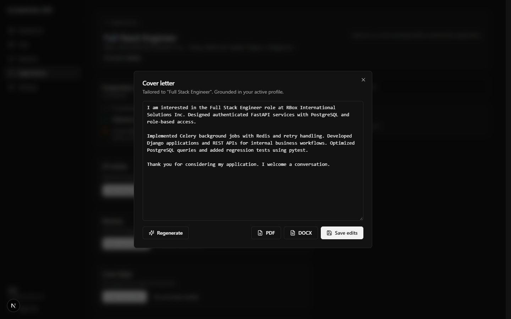

# User guide

Use this guide to move from a resume and a list of jobs to a reviewed
application package. You decide what to send and submit it yourself.

## Before you start

Run the app using the [backend setup](../backend/README.md#setup-and-start) and
[dashboard setup](../frontend/README.md#setup-and-start). Those guides contain
the installation commands and environment settings. The normal dashboard opens
at `http://localhost:3000`.

For a disposable evaluation, use the
[isolated portfolio walkthrough](../README.md#isolated-portfolio-walkthrough).
It has its own account, ports, and synthetic provider. It does not replace all
AI features. Resume parsing, cover-letter generation, and other provider-backed
features need the providers described in the backend guide.

Use an invented identity and resume when evaluating or taking screenshots.
The images below show the fictional `test@example.com` account and fictional
work experience. Job listings and company names come from the feed; the demo
account has not submitted applications to those employers. The images are
examples, not a separate downloadable demo dataset.

## 1. Create an account and upload a resume

1. Open `/signup` on your local dashboard.
2. Enter **Name**, **Email**, and **Password**, then choose **Create account**.
   If you already have an account, use **Sign in** instead.
3. Open **Settings → Profile**. On a narrow screen, open **Menu** first.
4. Choose **Choose file** and select a PDF or DOCX resume, up to 10 MB.
5. Wait for parsing to finish. It runs in the background, so you can leave the
   page and return. Your first successful import supplies the active profile.
6. Check the extracted name, skills, work history, education, and other details.
   Use **Edit profile** to correct mistakes, then **Save all changes**.

You should see your profile and summary counts for experience, skills, roles,
and certifications. Check the extracted text; parsing can miss or misread details.

If you upload a replacement resume, it waits under **Imported resume drafts**.
Choose **Review draft**, check the extracted profile, then **Approve draft** if
you want to activate it. Read the confirmation carefully: approval permanently
deletes the previous uploaded resume and its resume-specific extracted data.
Saved applications and application documents remain. **Cancel** keeps the
current profile; **Reject draft** removes the pending import without replacing it.

## 2. Set your search preferences

1. Open **Settings → Preferences**.
2. Enter comma-separated target roles in **Job title**.
3. Enter comma-separated **Locations** and choose a **Remote preference**.
4. Choose **Save preferences**.

You should see **Preferences saved**. Saving preferences does not guarantee
that new listings will appear immediately. Ingestion depends on the configured
sources and running background services.

## 3. Find jobs and understand matches

1. Open **Jobs**. Search by title, company, or description, then choose **Search**.
2. Narrow the results with the source, remote, job type, shift, location, company,
   or origin filters.
3. Open a job and read the full description. Check its freshness and original
   listing as well; an imported listing is not proof that the role is still open.
4. Choose **Save Job** to keep it, or **Save & prepare** to start preparation.
   A saved job shows **Saved** and appears under **Applications**.
5. Open **Matches** to compare jobs with your active profile. Use
   **Refresh Match Rankings** when you want to request updated rankings.

*Use the ranking to choose jobs to investigate, then read their requirements.*

The profile relevance percentage describes the app's comparison with your
profile. It is not a chance of getting an interview or an offer. **Top skill gaps**
shows common missing keywords across matched jobs. Missing evidence may mean
your profile needs clarification; it is not a reason to add experience you
do not have.

On a job's detail page, check the matched skills, gaps, and any saved **AI fit
review**. If offered, choose **Get AI fit review** to request an explanation.
The application recommendation also uses your preferences and readiness rules;
it is separate from the skills explanation. Check those rules under
**Settings → Readiness** if a recommendation seems unexpected.

*The explanation adds context to the score. You make the final decision.*

## 4. Prepare your documents

Choose **Save & prepare** from a job, **Prepare application** on a saved job,
or its preparation link in **Applications**. You should see a preparation
checklist and separate sections for fit, resume, and cover letter.

### Review fit and tailor a resume

1. Read the fit context, then choose **Acknowledge fit context**.
2. Under **Resume**, choose **Tailor new resume**, then **Generate tailored resume**.
3. Review the draft, missing requirements, and supporting source evidence.
   Use **Keep original** where you prefer the original summary wording.
   Use **Omit bullet** only for experience you want left out of this version.
4. Choose **Save resume**, then close the dialog.
5. Choose **Select saved resume** to use it for this application. A saved draft
   and a selected draft are separate steps.

If a tailored resume already exists, use **View/edit saved resume** to review it.
You should see the selected resume's label in the workspace.

*Check suggestions against your actual experience before saving the draft.*

### Prepare a cover letter

1. Under **Cover letter**, choose **Create cover letter**, then **Generate draft**.
2. Read the result. Generation saves the draft; if you change its wording,
   choose **Save edits** before closing it.
3. Close the dialog and choose **Select saved letter** to use it in the application.
   Use **Edit saved letter** to return to it later.
4. If the application does not need a cover letter, choose **No cover letter needed**.

*The draft uses the active profile as its source. Review it before using it.*

The editor's **PDF** and **DOCX** buttons download the letter. For a file linked
to a specific reviewed package, use the package's **Exported files** section
described below.

### Review and approve the package

1. If needed, enter a **Question** and **Answer** under **Manual questions**,
   choose **Add question**, then **Mark complete** after checking the answer.
   Skip this section if there are no questions to track.
2. Save or discard any unsaved document edits. Finish the preparation checklist.
3. Choose **Review package**. Read the package preview, including the selected
   documents and manual answers.
4. Use **Review documents** for optional advisory feedback. Review any findings
   and choose **Keep wording** or **Will revise** as appropriate. The review
   does not change the documents or approve them for you.
5. Choose **Approve package** when you are satisfied with the reviewed version.

The package is a frozen copy: later edits do not rewrite it. If you change a
selected document or other preparation details, review a new package and approve
the current version before continuing. If the app asks you to re-select a changed
document, do that first.

Under **Exported files**, use **Generate Resume PDF**, **Generate Resume DOCX**,
or the corresponding cover-letter buttons to save files from the frozen package.
Check the result and open the downloaded file yourself. File checks do not
replace a visual check; DOCX content and structure checks do not verify page layout.

Once a current package is approved, **Open application** opens the external
application page. Review and submit there yourself. Opening the page, generating
a file, or approving a package does not submit an application.

## 5. Track next actions and actual submissions

### Keep a next action

1. Open **Applications** and the three-dot menu for a job.
2. Choose **Set action**, or **Edit next action** if one exists.
3. Choose a **Type**, add a **Next-action note**, and optionally set a **Due date**.
4. Choose the save button shown: **Save new next action** for a new action or
   **Save next action** for an edit.
5. After doing the task, choose **Complete next action** from the menu. Use
   **Add next action** when you are ready to record the next task.

Use **Notes** for application notes and **Change status** to record actual
progress, such as applied, interview, or offer. The dashboard's **Action Center**
groups actions that need attention. Status is a tracking record, not confirmation
from an employer.

*The demo jobs are saved only; no employer application has been submitted.*

### Record what you sent

After you actually submit an application:

1. Open its workspace and find **Submission history**.
2. Choose **Confirm materials**.
3. Record whether you used a prepared package, other material, or do not know
   which material was sent. If you used a package, choose the right revision
   and select only retained files you know were sent.
4. Optionally enter the submitted time and a historical note, then choose
   **Confirm materials** to record the entry.
5. Use **View details** to inspect the entry and any linked historical package.

Do not assume that the current documents were the ones submitted. Submission
history records your confirmation and does not send anything to the employer.
For an evaluation, record only clearly labeled synthetic internal history.

For interview practice, choose **Prepare for interview** and use a confirmed
historical submission or explicitly choose the current-profile fallback.

## 6. Use the optional Chrome extension

Follow the extension guide to [build and install](../extension/README.md#build-and-install)
it, then [pair it with the dashboard](../extension/README.md#pair-with-the-dashboard).
Check that the popup shows the intended account before capturing jobs or using
autofill previews.

Review the preview and initiate filling yourself. The extension skips fields
excluded by its safety rules and never submits an application automatically.
Keep pairing codes and tokens out of screenshots. The extension's default
ports target normal local development, not the isolated portfolio harness.

## If something does not work

| What you see | What to try |
| --- | --- |
| Resume parsing is still running | Return to Profile and check the background task result. Confirm the file is PDF/DOCX and within 10 MB. |
| Parsing or generation fails | Check the backend guide's provider settings and required services. Keep your existing material and retry after resolving the cause. |
| No jobs or matches | Check saved preferences, available feed data, and background services. Request updated rankings after a usable profile and jobs are available. |
| Review package is unavailable | Finish the checklist and manual questions, save or discard edits, and re-select any changed documents. The job must also have an available application link. |
| Preparation changed elsewhere | Read the refreshed workspace and review the current selections before trying again. |
| Document review is unavailable | Your documents remain unchanged. Check the provider and worker setup; a missing review is not a successful review. |
| A saved file did not download | Use **Download** on the retained file and inspect its check report. |
| Extension pairing fails | Follow the extension guide's troubleshooting steps and generate a fresh pairing code if needed. |

For a reproducible issue, include steps, expected and actual behavior, and
sanitized error text in the repository Issues tab. Do not include credentials,
cookies, personal resumes, or account data.

[Back to the README](../README.md)
